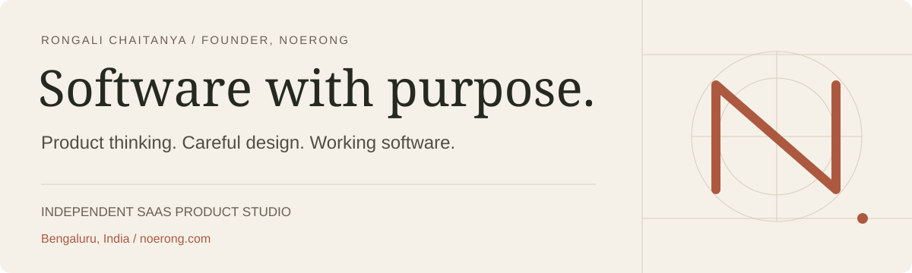

  

  <a href="https://noerong.com/projects"><strong>Explore the work</strong></a> &nbsp; / &nbsp;
  <a href="https://noerong.com/about">About the studio</a> &nbsp; / &nbsp;
  <a href="https://www.linkedin.com/in/rongalichaitanya">LinkedIn</a> &nbsp; / &nbsp;
  <a href="https://noerong.com/contact">Start a project</a>

## I'm Rongali

Founder of **[Noerong](https://noerong.com)**, an independent SaaS product studio. I turn operational problems into focused products for service businesses, agencies and small teams, from workflow and interface design through full-stack engineering, testing and deployment.

My work connects the experience a customer sees with the system a business needs behind it: clear inputs, useful next steps, dependable state changes and a documented handoff.

## Selected builds

| Product | The workflow | Explore |
| :--- | :--- | :--- |
| **[FrameProof](https://github.com/rongali-commits/frameproof)** | Image revisions, pinned feedback, controlled guest access and decisions tied to the exact version. | [Live demo](https://frameproof-visual-re-o866.bolt.host) · [Case study](https://noerong.com/projects/frameproof) |
| **[Seatloom](https://github.com/rongali-commits/seatloom)** | Creative workshop reservations, capacity, fair waitlists, booking changes and organizer check-in. | [Live demo](https://seatloom-workshop-pl-rcs7.bolt.host) · [Case study](https://noerong.com/projects/seatloom) |
| **[SignalRoom](https://github.com/rongali-commits/signalroom)** | Customer evidence, traceable themes, opportunity scoring and cited AI research answers. | [Live demo](https://signalroom-production-cda7.up.railway.app) · [Case study](https://noerong.com/projects/signalroom) |
| **[LeadDesk AI](https://github.com/rongali-commits/leaddesk-ai)** | Approved FAQ answers, structured quote requests and a private lead dashboard; optional server-side AI. | [Live demo](https://leaddesk-ai-production.up.railway.app) · [Case study](https://noerong.com/projects/leaddesk-ai) |
| **[FollowDesk](https://github.com/rongali-commits/followdesk)** | Lead stages, scheduled follow-up, booking handoff, cancellation controls and activity history. | [Live demo](https://followdesk-production.up.railway.app) · [Case study](https://noerong.com/projects/followdesk) |
| **[LedgerFlow](https://github.com/rongali-commits/invoice-report-automation)** | CSV validation and a tested Python invoice/report pipeline with PDF output and auditable exports. | [Browser edition](https://rongali-commits.github.io/invoice-report-automation/) · [Source](https://github.com/rongali-commits/invoice-report-automation) |

These are independent studio projects. Public demonstrations use fictional or sample records. Repository documentation explains the implemented workflow, setup, checks and deployment boundaries. LedgerFlow's browser edition and Python pipeline are separate implementations; LeadDesk's public demo currently serves deterministic approved answers.

## Engineering interests

- **Product workflows:** proposal decisions, reservations, client delivery and operational dashboards.
- **Practical AI:** approved sources, traceable evidence, fallback behavior and human review.
- **Python automation:** validated data, documents, reports, APIs and repeatable processing.
- **Interface systems:** responsive layouts, accessible interactions and useful states beyond the happy path.

**Core tools:** TypeScript · React · Next.js · Python · FastAPI · PostgreSQL · Supabase · SQLite · GitHub Actions

## Working together

Start with one workflow and the result your team needs. I can adapt an existing Noerong product or build a focused system around it, with scope, milestones, revisions and handoff agreed up front.

**[Discuss a project](https://noerong.com/contact)** · [hello@noerong.com](mailto:hello@noerong.com)

Bengaluru, India · UTC+5:30. Outside the studio, I write [personal essays](https://noerong.com/essays) on history, philosophy and technology.
